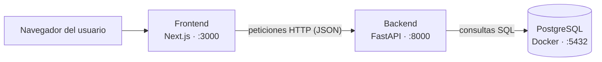
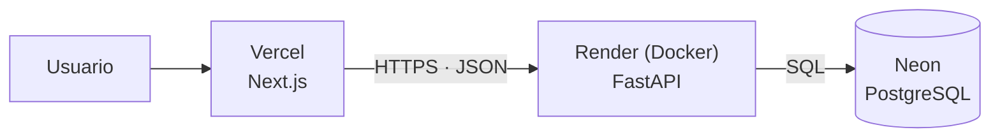
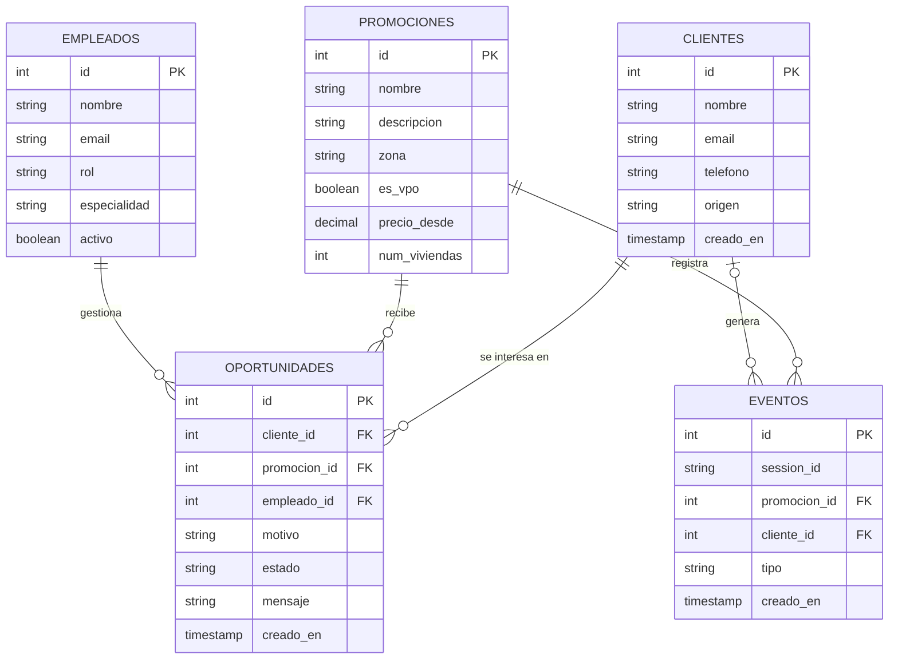

# **🏠 Inmo-leads**
**Plataforma de captación y análisis de leads para una promoción inmobiliaria de pisos y VPO.** 
Automatiza la captura de contactos y compara el comportamiento de quienes compran y quienes no, con una vista distinta según el responsable (marketing o comercial).

> Proyecto de portfolio, inspirado en un caso real del sector inmobiliario. **Todos los datos son ficticios.**

## 🔗 Demo en vivo

| | Enlace |
|---|---|
| 🌐 **Web** (Next.js en Vercel) | https://inmo-leads-umber.vercel.app |
| ⚙️ **API** (FastAPI en Render) | https://inmo-leads-api.onrender.com |
| 📖 **Documentación de la API** | https://inmo-leads-api.onrender.com/docs |

> > ⏳ El backend está en un plan gratuito: tras un rato sin uso se "duerme" y la **primera visita puede tardar cerca de un minuto** en responder. Después va con normalidad.

<details>
<summary>👩‍💻 Sobre mí</summary>
Hola !! Soy Belén, estudié un FP Superior de Desarrollo de Aplicaciones Multiplataforma y después una especialización en IA y Big Data. 

Creare desde cero una web inmobiliaria que automatizará la captación de clientes analizando quién compra y quién no, y qué diferencia hay entre unos y otros.
Hacerlo todo con diseño web y enviar al cliente la vista que necesite cada responsable.

El objetivo es una demo desde cero (el desarrollo, aprendizaje y despliegue será gratutito), pasando por todo el proceso hasta desplegarla, para volver a familiarizarme con el diseño web.

📫 GitHub: [@belenmrqz](https://github.com/belenmrqz)

</details>


## 📌 Estado del proyecto

**Hecho**
- [x] Estructura del monorepo (backend + frontend)
- [x] Backend FastAPI arrancando con documentación automática
- [x] Esqueleto del frontend con Next.js
- [x] PostgreSQL local con Docker
- [x] Modelo de datos (5 tablas) y primera migración con Alembic
- [x] Datos de prueba (`seed.py`)
- [x] Endpoints de promociones (`GET /promociones`, `GET /promociones/{id}`)
- [x] Web con el listado de promociones en tarjetas, conectada a la API
- [x] **Despliegue en producción** (Vercel + Render con Docker + Neon)
- [x] Código del backend comentado y explicado

**Siguientes pasos**
- [ ] Filtro por tipo (VPO / libre) y ficha de detalle de cada promoción
- [ ] Endpoints de clientes, oportunidades y eventos
- [ ] Formulario de contacto con reparto del caso al empleado según el motivo
- [ ] Captación automatizada con email de confirmación
- [ ] Tracking de eventos (visitas, clics, envíos de formulario)
- [ ] Panel de análisis (embudo y comparativa compradores / no compradores)
- [ ] Login con dos roles (marketing y comercial)
- [ ] CI con GitHub Actions
<br>


## ✨ Qué incluirá

- **Web pública** con ficha de cada promoción y formulario de contacto.
- **Captación automatizada**: el lead se guarda en la base de datos y se envía un email automático.
- **Tracking de eventos**: visitas, clics y envíos de formulario.
- **Panel de análisis** con embudo de conversión y comparativa entre compradores y no compradores, con vistas distintas para marketing y comercial.


## 🧰 Stack

| Capa  | Tecnología | Por qué |
|-----------|-----------|-----------|
| Frontend | *Next.js + TypeScript* | Es lo más pedido para sustituir WordPress, y TypeScript es casi un requisito en ofertas actuales. Da SEO bueno, que importa mucho en una inmobiliaria. |
| Backend | *FastAPI (Python)* | 	El análisis de compradores y no compradores se hace natural con pandas, y enlaza con tu especialización en IA y Big Data. |
| Base de datos | *PostgreSQL* | 	Estándar del mercado |
| Despliegue | *Vercel (web), Render con Docker (backend), Neon (base de datos)* | 	Gratis, y cubre Docker y CI/CD con GitHub Actions |
| Repositorio | *Git-Hub* | Mi gran compañero durante estos años |
| Entorno de Desarrollo | *Visual Studio Code* | Un entorno versátil que facilita el desarrollo |
| Herramientas | *uv, Ruff y Docker* | Gestión de dependencias Python, revisión de código y contenedores |

<br>

## 🏗️ Arquitectura

**En desarrollo (mi ordenador):**
 

 
**En producción:**
 


| Componente | Tecnología | Responsabilidad |
|---|---|---|
| Frontend | Next.js + TypeScript | Renderizar la web pública (promociones, formulario de contacto) y el panel de análisis |
| Backend | FastAPI + SQLModel | Exponer una API REST, validar datos, aplicar reglas de negocio y calcular métricas |
| Base de datos | PostgreSQL (Docker en local) | Persistir promociones, leads y eventos |

Separo frontend y backend para poder modificar el diseño sin tocar la lógica ni los datos, y al revés. Además, la misma API puede servir a otras interfaces, cada parte se despliega y escala por separado y cada una usa el lenguaje más adecuado.

### **Comunicación mediante API REST**

El backend expone *endpoints*: direcciones a las que el frontend envía peticiones HTTP. El método indica la acción, y los datos viajan en formato JSON.

| Método | Acción | Ejemplo (planificado) |
|---|---|---|
| `GET` | Consultar datos | `GET /promociones` devuelve la lista de promociones (**ya implementado**) |
| `POST` | Crear un registro | `POST /leads` guarda un contacto del formulario (**planificado**) |
| `PATCH` | Modificar un registro | Marcar un lead como comprador |
| `DELETE` | Eliminar un registro | Borrar un lead |

### **Recorrido de una petición**
Si abro, por ejemplo, la dirección `http://127.0.0.1:8000/promociones` ocurre lo siguiente:
 
```text
Navegador  →  GET /promociones
   ↓
main.py        enruta la petición al router de promociones (por su prefijo)
   ↓
routers/promociones.py    ejecuta la función listar_promociones
   ↓
database.py    get_session() abre una sesión con PostgreSQL
   ↓
PostgreSQL     devuelve las filas de la tabla promociones
   ↓
schemas.py     PromocionRead decide qué campos salen y los convierte a JSON
   ↓
Navegador  ←  respuesta JSON
```
 
Y en la web, el frontend (Next.js) hace esa misma petición **desde su servidor** y entrega al navegador el HTML ya construido con las tarjetas.

<br>


## 📁 Estructura del repositorio
```text
inmo-leads/
├── 📁 backend/                   ← FastAPI + uv
|   ├── 📁 __pycache__
|   ├── 📁 .ruff_cache
|   ├── 📁 .venv                  ← Entorno virtual
|   ├── 📁 migrations             ← Historial de cambios de la BBDD (Alembic)
|   |   ├── 📁 __pycache__
|   |   ├── 📁 versions           ← Una migración por cada cambio
|   |   ├── 🐍 env.py              ← Conecta Alembic con mis modelos y mi base de datos
|   |   └── 📄 script.py.mako      ← Plantilla con la que se generan las migraciones
│   ├── 📁 routers/                ← Endpoints agrupados por tema
│   │   ├── 🐍 __init__.py         ← Vacío: marca la carpeta como paquete
│   │   └── 🐍 promociones.py      ← Endpoints de promociones
|   |
|   ├── 📄 .env.example        ← Ejemplo de variables de entorno
|   ├── 📄 .python-versiom
|   ├── 📄 alembic.ini         ← Configuración de Alembic
|   ├── 🐍 config.py           ← Lee la configuración desde .env
|   ├── 🐍 database.py         ← Conexión a PostgreSQL y sesiones
|   ├── 🐋 Dockerfile          ← Imagen del backend para producción
|   ├── 🐍 main.py             ← Aplicación FastAPI
|   ├── 🐍 models.py           ← Modelos: las tablas escritas en Python
|   ├── 📄 pyproject.toml      ← Ficha del proyecto back (dependencias)
│   ├── 🐍 schemas.py          ← formato de salida de la API
│   ├── 🐍 seed.py             ← Datos de prueba
|   └── 📄 uv.lock
|
├── 📁 frontend/               ← Next.js + TypeScript
|   ├── 📁 .next
|   ├── 📁 node_modules        ← Aquí se descargan las librerías
|   ├── 📁 public              ← Imágenes y archivos estáticos
│   ├── 📁 src/
│   │   ├── 📁 app/
│   │   │   ├── 📄 globals.css
│   │   │   ├── 📄 layout.tsx      ← Estructura común a todas las páginas
│   │   │   └── 📄 page.tsx        ← Página de inicio con las promociones
│   │   └── 📁 lib/
│   │       └── 📄 api.ts          ← Funciones que llaman a la API
|   ├── 📄 .gitingore
|   ├── 📄 eslint.confing-mjs
|   ├── 📄 next-env.d.ts
|   ├── 📄 next.config.ts
|   ├── 📄 package-lock.json
|   ├── 📄 package.json        ← Ficha del proyecto font (dependencias)
|   └── 📄 tsconfig.json
|
├── 🐋 docker-compose.yml     ← PostgreSQL local para desarrollar
├── .github/workflows/         ← CI (más adelante)
├── .gitignore                 ← Aquello que Git no deber subir
└── 🛈 README.md  
```
> No aparecen porque Git los ignora y no están en el repositorio: `backend/.env` (credenciales), `backend/.venv` (entorno virtual), `frontend/node_modules` (librerías), `frontend/.next` (compilación) y las carpetas `__pycache__` y `.ruff_cache`.
 
<br>

<details>
<summary>🚀 Cómo ejecutarlo en local</summary>


**Requisitos:** Git, Node.js (LTS), [uv](https://docs.astral.sh/uv/), Docker Desktop.

```powershell
# 1. Clonar el repositorio
git clone https://github.com/belenmrqz/Inmo-leads.git
cd Inmo-leads

# 2. Variables de entorno
Copy-Item backend/.env.example backend/.env

# 3. Base de datos (con Docker Desktop abierto)
docker compose up -d
```

Después, en **dos terminales distintas**:

```powershell
# Terminal 1 · Backend  →  http://127.0.0.1:8000  (documentación en /docs)
cd backend
uv sync
uv run fastapi dev main.py
```

```powershell
# Terminal 2 · Frontend  →  http://localhost:3000
cd frontend
npm install
npm run dev
```
</details>


## 🗺️ Hoja de ruta
Una mini plataforma de captación de una promoción de pisos y VPO, con datos ficticios, que incluye:

- Una web pública con ficha de piso y formulario de contacto.
Captación automatizada: guarda el lead en la base de datos y envía un email automático.
- Tracking de eventos: visitas, clics y envíos de formulario.
- Un panel de análisis con embudo de conversión y comparativa entre compradores y no compradores, con vistas distintas según el responsable (marketing o comercial).

### 📚 Cómo estoy aprendiendo lo nuevo (gratis)

- **Next.js:** curso oficial [Learn Next.js](https://nextjs.org/learn)
- **TypeScript:** [Handbook oficial](https://www.typescriptlang.org/docs/handbook/intro.html) y [freeCodeCamp](https://www.freecodecamp.org/)
- **FastAPI y SQLModel:** [documentación de FastAPI](https://fastapi.tiangolo.com/) y [de SQLModel](https://sqlmodel.tiangolo.com/)
- **Docker y GitHub Actions:** [Docker Docs](https://docs.docker.com/) y [GitHub Actions](https://docs.github.com/actions)

<br>

### 🧠 Decisiones técnicas
 
- **FastAPI en lugar de Spring Boot:** conozco ambos, pero el análisis de datos con pandas es más natural en Python.
- **Next.js con componentes de servidor:** la página pide los datos a la API desde el servidor y entrega el HTML ya construido. Es bueno para el SEO y evita exponer la dirección de la API en el navegador.
- **Monorepo:** frontend y backend en un único repositorio, para que el proyecto completo se vea de un vistazo.
- **Neon para la base de datos:** el PostgreSQL gratuito de Render caduca a los 30 días, y Neon ofrece un plan gratuito más estable para una demo.
- **Valores permitidos como texto, no como `ENUM` de PostgreSQL:** simplifica las migraciones. La validación estricta se hará en la API.
- **Separar modelo y schema:** `models.py` es la tabla y `schemas.py` lo que ve el exterior, para poder ocultar campos internos en el futuro.
- **Configuración por variables de entorno:** el mismo código funciona en local y en producción sin tocarlo.

<br>

### 🌿 Flujo de trabajo con Git
 
Trabajo con **una rama por funcionalidad**, que se integra en `main` mediante un *Pull Request*.
 
| Rama | Para qué sirve |
|---|---|
| `main` | La versión estable del proyecto. Siempre debe funcionar, y de ella sale el despliegue |
| `feat/nombre` | Una funcionalidad nueva |
| `fix/nombre` | Corrección de un error |
| `docs/nombre` | Solo documentación |
 
**Ramas que he usado:** `feat/modelo-datos`, `feat/endpoint-promociones`, `aclaraciones_codigo` (comentar el código), `feat/frontend-promociones` y `feat/despliegue`.

### 🌐 Despliegue en producción 

<details>
<summary>More</sumary>

La demo está desplegada con tres servicios gratuitos, cada uno con una responsabilidad:

| Servicio | Qué aloja | Configuración principal |
|---|---|---|
| **Neon** | Base de datos PostgreSQL | Región Frankfurt, conexión directa (sin *pooling*) |
| **Render** | Backend FastAPI en Docker | Runtime Docker, *Root Directory* `backend`, región Frankfurt, *Health Check* en `/health` |
| **Vercel** | Frontend Next.js | *Root Directory* `frontend`, despliegue automático con cada cambio en `main` |

**Variables de entorno** (los valores nunca se suben al repositorio):

| Servicio | Variable | Para qué sirve |
|---|---|---|
| Render | `DATABASE_URL` | Cadena de conexión a Neon. Empieza por `postgresql+psycopg://` porque mi código usa el driver `psycopg` |
| Render | `CORS_ORIGINS` | Direcciones web autorizadas a llamar a la API, separadas por comas y **sin barra final** |
| Vercel | `API_URL` | Dirección pública del backend en Render |

**Cómo lo hice:**
1. Creé el proyecto en **Neon** y copié su cadena de conexión cambiando el comienzo a `postgresql+psycopg://`.
2. Apliqué las migraciones y los datos de prueba a Neon **desde mi ordenador**, definiendo `DATABASE_URL` solo para esos comandos. Funciona porque las variables del sistema tienen prioridad sobre el `.env` (ver `config.py`).
3. Escribí el `Dockerfile` del backend y un `.dockerignore` (para que no entren en la imagen el `.venv` ni el `.env`).
4. Creé el servicio en **Render** apuntando al repositorio y definí sus variables de entorno.
5. Creé el proyecto en **Vercel** con la carpeta `frontend` y la variable `API_URL`.

**El `Dockerfile` del backend:**
- Parte de `python:3.12-slim` e instala las dependencias con `uv sync --frozen --no-dev`, es decir, exactamente lo que dice `uv.lock` y sin las herramientas de desarrollo.
- Copia primero las dependencias y luego el código: si solo cambio código, Docker reutiliza la capa de librerías.
- Al arrancar ejecuta `alembic upgrade head` (aplica las migraciones pendientes) y después `fastapi run` en el puerto que le asigna Render.

**CORS:** el navegador solo deja que una web llame a una API de otra dirección si esa API lo autoriza. La API lee `CORS_ORIGINS` y autoriza a `localhost:3000` y a la web de Vercel. Para el listado de promociones no hace falta (la petición sale del servidor de Next.js), pero será imprescindible para el formulario, que se enviará desde el navegador.

**Limitación del plan gratuito:** Render duerme el servicio tras 15 minutos sin uso, así que la primera petición tarda cerca de un minuto en responder.

</details>

<br>
<br>
<br>


# 📓 Diario de desarrollo

Aquí cuento, paso a paso y en el orden en que lo hice, qué construí, cómo funciona y por qué.

## **Pre-instalaciones y creación del proyecto**
<details>
<summary><b>¿Cómo monté el proyecto?</b></summary>

### 1. Instalaciones en PowerShell y creación
```powershell
PS C:\WINDOWS\System32> git --version
git version 2.51.2.windows.1

PS C:\WINDOWS\System32> node --version
v24.21.0

PS C:\WINDOWS\System32> uv --version
uv 0.9.2 (141369ce7 2025-10-10)

PS C:\WINDOWS\System32> docker --version
Docker version 28.4.0, build d8eb465
```

Creamos un repositorio nuevo en GitHub marcando **_readme.md_** y **.gitignore** (python).<br>
Luego, clonamos el repositorio en nuestros archivos locales.

```powershell
PS C:\Users\BelenML\Proyectos_BML> git clone https://github.com/belenmrqz/Inmo-leads.git
Cloning into 'Inmo-leads'...
remote: Enumerating objects: 4, done.
remote: Counting objects: 100% (4/4), done.
remote: Compressing objects: 100% (3/3), done.
remote: Total 4 (delta 0), reused 0 (delta 0), pack-reused 0 (from 0)
Receiving objects: 100% (4/4), done.

PS C:\Users\BelenML\Proyectos_BML> cd inmo-leads

PS C:\Users\BelenML\Proyectos_BML\inmo-leads> code .
```
<br>

### 2. Back-End con uv
```powershell
PS C:\Users\BelenML\Proyectos_BML\inmo-leads> uv init backend
Initialized project `backend` at `C:\Users\BelenML\Proyectos_BML\inmo-leads\backend`

PS C:\Users\BelenML\Proyectos_BML\inmo-leads> cd backend

PS C:\Users\BelenML\Proyectos_BML\inmo-leads\backend> uv add "fastapi[standard]" sqlmodel alembic "psycopg[binary]" pydantic-settings
Using CPython 3.12.12
Creating virtual environment at: .venv
...

PS C:\Users\BelenML\Proyectos_BML\inmo-leads\backend> uv add --dev pytest ruff
Resolved 74 packages in 488ms
Prepared 4 packages in 1.14s
Installed 5 packages in 672ms
...

PS C:\Users\BelenML\Proyectos_BML\inmo-leads\backend> uv run fastapi dev main.py

 ⚡️ Starting FastAPI in development mode

 🐍 Using import string: main:app

 🌐 Server started at http://127.0.0.1:8000
    Documentation at http://127.0.0.1:8000/docs

  Logs:

 ▕  Will watch for changes in these directories:
    ['C:\\Users\\BelenML\\Proyectos_BML\\inmo-leads\\backend']
 ▕  Uvicorn running on http://127.0.0.1:8000 (Press CTRL+C to quit)
 ▕  Started reloader process [37680] using WatchFiles
 ▕  Started server process [33064]
 ▕  Waiting for application startup.
 ▕  Application startup complete.
 ▕  127.0.0.1:57668 - "GET / HTTP/1.1" 404
 ▕  127.0.0.1:57668 - "GET /favicon.ico HTTP/1.1" 404
 ▕  127.0.0.1:59517 - "GET /health HTTP/1.1" 200
```

uv crea el entorno virtual ***(.venv)*** y el ***pyproject.toml*** por ti, sin ***pip*** ni activaciones manuales. Si abres ***http://127.0.0.1:8000/docs*** y ves la documentación automática de FastAPI, el backend funciona.
<br> 

Se instalan librerías que necesita el backend y adjunta ***pyproject.tom*** para que cualquiera que clone este proyecto pueda utilizar las mismas.
Por último enciende el backend y convierte mi ordenador en un pequeño servidor.

### 3. Front-End con Next.js
```powershell
PS C:\Users\BelenML\Proyectos_BML\inmo-leads\backend> cd ..
PS C:\Users\BelenML\Proyectos_BML\inmo-leads> npx create-next-app@latest frontend
Need to install the following packages:
create-next-app@16.4.3
... #Aquí está creando el proyecto frontend, debes marcar -> TypeScript, ESLint, Tailwind CSS, App Router y carpeta src/

PS C:\Users\BelenML\Proyectos_BML\inmo-leads> cd frontend

PS C:\Users\BelenML\Proyectos_BML\inmo-leads\frontend> npm run dev
```

texto

### 4. PostgresSQL local con Docker
En la raiz del proyecto creamos el archivo ***docker-compose.yml*** y lo rrelenamos. 
Abrimos docker desktop y esperamos a que arranque, luego, ejecutamos en la conosla : 
```powershell
PS C:\Users\BelenML\Proyectos_BML\inmo-leads> docker compose up -d
time="2026-10-29T19:23:47+01:00" level=warning msg="project has been loaded without an explicit name from a symlink. Using name \"inmo-leads\""
[+] Running 15/15
...
```
### 4. Variables y configuraciones de VS
Tu backend necesita saber cómo conectarse a la base de datos: usuario, contraseña, dirección... Esos datos no se escriben dentro del código, porque el código se sube a GitHub y lo vería todo el mundo. Se guardan en un archivo aparte, ***.env***, que se queda solo en tu ordenador.

Para que quien clone tu repo sepa qué datos hacen falta, subes también un archivo de ejemplo, ***.env.example***, con valores falsos.

!!! Recuerda añadir .env en tu archivo .gitignore

**Extensiones útiles en VS:**
| Extenxión  | Uso |
|-----------|-----------|
| _Python_ | Soporte básico de Python |
| _Ruff_ | Revisa tu código Python mientras escribes |
| _ESLint_ | Revisa tu código frontend mientras escribes |
| _Tailwind CSS IntelliSense_ | Te sugiere las clases de Tailwind al escribirlas |
| _Docker_ | Muestra tus contenedores desde VS Code |

</details>

## **Modelado de Datos**
<details>
<summary><b>Explicación de la Base de Datos y sus pasos</b></summary>  
La base de datos tiene 5 tablas.
La persona ('clientes') está separada de su interés en una promoción ('oportunidad'), de modo que un mismo cliente puede terner varias oportunidades sin repetir sus datos.



| Tabla | Qué guarda |
|---|---|
| `clientes` | La persona que contacta: nombre, email, teléfono y origen (Instagram, Google...) |
| `empleados` | Quienes usan el panel. Su `rol` decide qué vista ven y su `especialidad` qué casos reciben |
| `promociones` | Las promociones de viviendas, indicando si son VPO |
| `oportunidades` | El interés de un cliente en una promoción: motivo, estado y empleado asignado |
| `eventos` | Acciones del visitante en la web (visita, clic, envío de formulario), identificadas por sesión |
 

 ### Reparto de casos según motivo
 Cuando alguien envía el formulario, elige un **motivo**. 
 El backend asgina el caso a un empleado activo cuya 'especialidad coincide con ese motivo. 

 | Motivo | Significado |
|---|---|
| `todo_tipo` | Interesado en pisos de cualquier tipo |
| `solo_vpo` | Interesado únicamente en VPO |
| `asesoramiento` | Necesita asesoramiento |
| `vender` | Quiere vender su piso |
 
`vender` es un caso especial: esa persona no es compradora, no tiene una promoción asociada (por eso `promocion_id` es opcional) y se excluirá de la comparativa entre compradores y no compradores.
 
**Estados de una oportunidad:** `nuevo`, `contactado`, `visita`, `reserva`, `comprador` y `descartado`.

### ¿Qué se ha creado y como?
En este paso paso del diseño de la base de datos a tablas reales en PostgreSQL. Se hace con SQLModel (las tablas escritas como clases de Python) y Alembic (el historial de cambios de la base de datos).

Archivos que se han creado nuevos: 
- **`backend/config.py`** → Configuración, Lee la variable `DATABASE_URL` desde `.env` usando `pydantic-settings`. Expone un único objeto `settings` que el resto del código importa, así las credenciales nunca están escritas en el código.
- **`backend/database.py`** → Conexión, Crea el `engine`, el objeto que manteine la conexión con PostgreSQL, y la función `get_session()`, que entrega una sesión de base de datos y la cierra al terminar. Más adelante los endpoints de FastAPI la recibirán como dependencia.
- **`backend/models.py`** →

### ***Alembic: migraciones***
Una migración es un archivob que describe un cambio en la estructura de la bbdd.
Así el esquema queda versionado en GitHub, igual que el código, y cualquiera puede reproducirlo. 

He creado `alembic.ini` y la carpeta `migrations/` con el comando _"uv run alembic init migrations"_, luego ajuste los siguientes parámetros:
-  En `migrations/env.py` importé `SQLModel`, `settings` y `models`. Importar `models` es lo que permite a Alembic conocer mis tablas.
- En `env.py` cambié `target_metadata = None` por `target_metadata = SQLModel.metadata`, para que Alembic compare contra mis modelos.
-  En `env.py`, tras `config = context.config`, añadí `config.set_main_option("sqlalchemy.url", settings.database_url)`. Así Alembic usa la base de datos de mi `.env` en lugar de la dirección de ejemplo de `alembic.ini`.
- En `migrations/script.py.mako` añadí `import sqlmodel`; sin él, las migraciones generadas no reconocen los campos de texto de SQLModel.

Después generé y apliqué mi primera migración:

```powershell
uv run alembic revision --autogenerate -m "tablas iniciales"
uv run alembix upgrade head
```
| Comando | Qué hace |
|---|---|
| `revision --autogenerate` | Compara mis modelos con la base de datos y escribe un archivo en `migrations/versions/` con las instrucciones para crear las tablas (`upgrade`) y para deshacerlas (`downgrade`) |
| `upgrade head` | Ejecuta las migraciones pendientes hasta la última versión |
 
Alembic crea además una tabla `alembic_version`, donde guarda en qué versión está la base de datos.

<br>

**¿Cómo cambiaré la base de datos a partir de ahora?**
 
1. Modifico `models.py` (por ejemplo, añado un campo).
2. Genero una migración: `uv run alembic revision --autogenerate -m "descripción del cambio"`.
3. Reviso el archivo generado.
4. La aplico: `uv run alembic upgrade head`.
Comandos útiles de Alembic:
 
| Comando | Para qué |
|---|---|
| `uv run alembic current` | Ver en qué versión está la base de datos |
| `uv run alembic history` | Ver el historial de migraciones |
| `uv run alembic downgrade -1` | Deshacer la última migración |

<br>
 
**Ruff: revisión del código:**

Ruff revisa el estilo del código. Dos comandos que uso antes de cada commit:
 
```powershell
uv run ruff check .          # muestra los avisos
uv run ruff check . --fix    # corrige automáticamente los que se pueden
```
 
Me avisó de dos cosas: que `datetime.UTC` sustituye a `timezone.utc` desde Python 3.11, y que los `import` deben ir ordenados (primero librerías externas, luego los archivos propios).
</details>

## **Datos de prueba y primer endpoint**
<details>
<summary><b>De la base de datos a la respuesta en el navegador</b></summary>
El flujo seguido es: Datos en la BBDD → endpoint en la API → respuesta en el navegador. 
Con esto queda comprobado que PostgreSQL, los modelos y FastAPI funcionan juntos. 


### ¿Qué se ha creado y como?

Archivos que se han creado nuevos: 
- **`backend/seed.py`** → Script que inserta promociones y empleados ficticios para tener con qué trabajar. Se ejecuta con el comando `uv run python seed.py`.
- **`backend/schemas.py`** → Formato de salida. Con el método `PromocionRead` define qué campos devuelve la API. Es una clase SQLModel que no crea ninguna tabla, solo describe datos. Separa el modelo (la tabla) del schema (lo que ve el exterior) permitirá ocultar campos internos más adelante.
- **`backend/routers/promociones.py`** → Endpoints, dónde el sistema recibe solicitudes. Un router agrupa los endpoints de un mismo tema. necesita un archivo `__init__`.py vacío para que Python la reconozca como paquete.
- **`backend/main.py`** → Crea la aplicación y registra el router con `app.include_router(...)`. Mantiene el endpoint `/health`, que sirve para comprobar que el servidor está vivo (y más adelante, para el despliegue).

| Endpoint disponibles| Resultado |
| -------- | -------- |
| `GET /healt` | `{"status": "ok"}` |
| `GET /promociones` | Lista de todas las promociones |
| `GET /promociones?es_vpo=true` | Solo las promociones VPO |
| `GET /promociones/{id}` | Una promoción; error 404 si no existe |

Códigos de respuesta que aparecen: 
- 200 (todo correcto)
- 404 (no existe)
- 422 (dato inválido, por ejemplo /promociones/abc, porque FastAPI valida que el id sea un entero).

FastAPI genera una documentación interactiva en http://127.0.0.1:8000/docs. Desde ahí se puede probar cada endpoint con el botón Try it out, sin escribir código.
</details>

## **Frontend conectado a la API**
<details>
<summary><b>La web con las promociones</b></summary>

**CORS en el backend.** En `main.py` añadí `CORSMiddleware`, que indica qué direcciones web pueden llamar a la API desde el navegador. Los orígenes permitidos se leen de la variable `CORS_ORIGINS` (en `config.py`), con `http://localhost:3000` por defecto.

**`frontend/src/lib/api.ts`.** Una pequeña capa que llama a la API:
- Lee la dirección de la API de la variable `API_URL` (por defecto `http://127.0.0.1:8000`).
- Define el tipo `Promocion`, el equivalente en TypeScript de `PromocionRead`.
- `getPromociones()` hace la petición con `fetch` y `cache: "no-store"` (datos frescos en cada visita).
- `precio_desde` llega como texto, porque la API envía los decimales como cadena.

**`frontend/src/app/page.tsx`.** La página de inicio es un **componente de servidor**: una función `async` que espera los datos de la API y devuelve JSX (HTML dentro de TypeScript). Recorre las promociones con `.map()` y dibuja una tarjeta por cada una, con la etiqueta VPO, la zona, la descripción, el precio formateado en euros con `Intl.NumberFormat` y el número de viviendas. Los estilos son clases de Tailwind y ya es responsive (una columna en móvil, dos en pantallas medianas y tres en grandes).

También cambié en `layout.tsx` el idioma a `es` y el título y la descripción de la página.

La dirección de la API en local va en `frontend/.env.local`, que Git ignora.
</details>