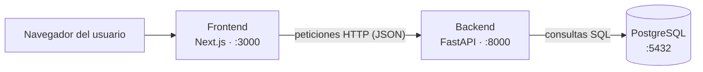

# **🏠 Inmo-leads**
**Plataforma de captación y análisis de leads para una promoción inmobiliaria de pisos y VPO.** Automatiza la captura de contactos y compara el comportamiento de quienes compran y quienes no, con una vista distinta según el responsable (marketing o comercial).

> Proyecto de portfolio, inspirado en un caso real del sector inmobiliario. **Todos los datos son ficticios.**

<details>
<summary>👩‍💻 Sobre mí</summary>
Hola !! Soy Belén, estudié un FP Superior de Desarrollo de Aplicaciones Multiplataforma y después una especialización en IA y Big Data. 

Hoy he tenido una entrevista para un perfil de "desarrollador multiusos" que me ha dado una idea para un nuevo proyecto.

Creare desde cero una web inmobiliaria que automatizará la captación de clientes analizando quién compra y quién no, y qué diferencia hay entre unos y otros.
Hacerlo todo con diseño web y enviar al cliente la vista que necesite cada responsable.

El objetivo es una demo desde cero (el desarrollo, aprendizaje y despliegue será gratutito), pasando por todo el proceso hasta desplegarla, para volver a familiarizarme con el diseño web.
</details>


## 📌 Estado del proyecto

- [x] Estructura del monorepo (backend + frontend)
- [x] Backend FastAPI arrancando con documentación automática
- [x] Esqueleto del frontend con Next.js
- [x] PostgreSQL local con Docker
- [ ] Modelos de datos y endpoints (Promoción, Lead, Evento)
- [ ] Web pública con ficha de piso y formulario de contacto
- [ ] Captación automatizada con email de confirmación
- [ ] Tracking de eventos (visitas, clics, envíos de formulario)
- [ ] Panel de análisis (embudo y comparativa compradores / no compradores)
- [ ] Login con dos roles (marketing y comercial)
- [ ] Despliegue (Vercel + Render + Neon)
- [ ] CI con GitHub Actions


## ✨ Qué incluirá

- **Web pública** con ficha de cada promoción y formulario de contacto.
- **Captación automatizada**: el lead se guarda en la base de datos y se envía un email automático.
- **Tracking de eventos**: visitas, clics y envíos de formulario.
- **Panel de análisis** con embudo de conversión y comparativa entre compradores y no compradores, con vistas distintas para marketing y comercial.


## 🧰 Stack

| Capa  | Tecnología | Por qué |
|-----------|-----------|-----------|
| Frontend | *Next.js + TypeScript* | Es lo más pedido para sustituir WordPress, y TypeScript es casi un requisito en ofertas actuales. Da SEO bueno, que importa mucho en una inmobiliaria. |
| Backend | *FastAPI (Python)* | 	El análisis de compradores y no compradores se hace natural con pandas, y enlaza con tu especialización en IA y Big Data. |
| Base de datos | *PostgreSQL* | 	Estándar del mercado |
| Despliegue | *Vercel (web), Render con Docker (backend), Neon (base de datos)* | 	Gratis, y cubre Docker y CI/CD con GitHub Actions |
| Repositorio | *Git-Hub* | Mi gran compañero durante estos años |
| Entorno de Desarrollo | *Visual Studio Code* | Un entorno versatil que facilita el desarrollo |


## 🏗️ Arquitectura



| Componente | Tecnología | Responsabilidad |
|---|---|---|
| Frontend | Next.js + TypeScript | Renderizar la web pública (promociones, formulario de contacto) y el panel de análisis |
| Backend | FastAPI + SQLModel | Exponer una API REST, validar datos, aplicar reglas de negocio y calcular métricas |
| Base de datos | PostgreSQL (Docker en local) | Persistir promociones, leads y eventos |

Separo frontend y backend para poder modificar el diseño sin tocar la lógica ni los datos, y al revés. Además, la misma API puede servir a otras interfaces, cada parte se despliega y escala por separado y cada una usa el lenguaje más adecuado.

### **Comunicación mediante API REST**

El backend expone *endpoints*: direcciones a las que el frontend envía peticiones HTTP. El método indica la acción, y los datos viajan en formato JSON.

| Método | Acción | Ejemplo (planificado) |
|---|---|---|
| `GET` | Consultar datos | `GET /promociones` devuelve la lista de promociones |
| `POST` | Crear un registro | `POST /leads` guarda un contacto del formulario |
| `PATCH` | Modificar un registro | Marcar un lead como comprador |
| `DELETE` | Eliminar un registro | Borrar un lead |


## 📁 Estructura del repositorio
```text
inmo-leads/
├── 📁 backend/                ← FastAPI + uv
|   ├── 📁 __pycache__
|   ├── 📁 .venv               ← Entorno virtual
|   ├── 📄 .env.example        ← Ejemplo de variables de entorno
|   ├── 📄 .python-versiom
|   ├── 📄 main.py             ← Aplicación FastAPI
|   ├── 📄 pyproject.toml      ← Ficha del proyecto back (dependencias)
|   └── 📄 uv.lock
|
├── 📁 frontend/               ← Next.js + TypeScript
|   ├── 📁 .next
|   ├── 📁 node_modules        ← Aquí se descargan las librerías
|   ├── 📁 public              ← Imágenes y archivos estáticos
|   └── 📁 src/app
|       ├── 📄 layout.tsx     ← Estructura común a todas las páginas
|       └── 📄 page.tsx       ← Página de inicio web
|   ├── 📄 .gitingore
|   ├── 📄 eslint.confing-mjs
|   ├── 📄 next-env.d.ts
|   ├── 📄 next.config.ts
|   ├── 📄 package-lock.json
|   ├── 📄 package.json        ← Ficha del proyecto font (dependencias)
|   └── 📄 tsconfig.json
|
├── docker-compose.yml         ← PostgreSQL local para desarrollar
├── .github/workflows/         ← CI (más adelante)
├── .gitignore                 ← Aquello que Git no deber subir
└── README.md  

|   ├── __pycache__
├──
```
<details>
<summary>🚀 Cómo ejecutarlo en local</summary>


**Requisitos:** Git, Node.js (LTS), [uv](https://docs.astral.sh/uv/), Docker Desktop.

```powershell
# 1. Clonar el repositorio
git clone https://github.com/belenmrqz/Inmo-leads.git
cd Inmo-leads

# 2. Variables de entorno
Copy-Item backend/.env.example backend/.env

# 3. Base de datos (con Docker Desktop abierto)
docker compose up -d
```

Después, en **dos terminales distintas**:

```powershell
# Terminal 1 · Backend  →  http://127.0.0.1:8000  (documentación en /docs)
cd backend
uv sync
uv run fastapi dev main.py
```

```powershell
# Terminal 2 · Frontend  →  http://localhost:3000
cd frontend
npm install
npm run dev
```
</details>


## 🗺️ Hoja de ruta
Una mini plataforma de captación de una promoción de pisos y VPO, con datos ficticios, que incluye:

- Una web pública con ficha de piso y formulario de contacto.
Captación automatizada: guarda el lead en la base de datos y envía un email automático.
- Tracking de eventos: visitas, clics y envíos de formulario.
- Un panel de análisis con embudo de conversión y comparativa entre compradores y no compradores, con vistas distintas según el responsable (marketing o comercial).

| Día  | Qué hago | Día  | Qué hago |
|-----------|-----------|-----------|-----------|
| 1º  | Requisitos, wireframes en Figma, estructura del repositorio y landing en Next.js | 4º  | Panel de análisis con gráficas y login sencillo con dos roles |
| 2º  | FastAPI + PostgreSQL: modelos Promoción, Lead y Evento, endpoints y Docker | 5º  | Despliegue, CI con GitHub Actions, README con capturas y revisión con Lighthouse |
| 3º  | Formulario conectado a la API, tracking de eventos y email automático |  |  |


### 📚 Cómo estoy aprendiendo lo nuevo (gratis)

- **Next.js:** curso oficial [Learn Next.js](https://nextjs.org/learn)
- **TypeScript:** [Handbook oficial](https://www.typescriptlang.org/docs/handbook/intro.html) y [freeCodeCamp](https://www.freecodecamp.org/)
- **FastAPI y SQLModel:** [documentación de FastAPI](https://fastapi.tiangolo.com/) y [de SQLModel](https://sqlmodel.tiangolo.com/)
- **Docker y GitHub Actions:** [Docker Docs](https://docs.docker.com/) y [GitHub Actions](https://docs.github.com/actions)

<br>

## Pre-instalaciones y creación del proyecto
<details>
<summary><b>¿Cómo monté el proyecto?</b></summary>

### 1. Instalaciones en PowerShell y creación
```powershell
PS C:\WINDOWS\System32> git --version
git version 2.51.2.windows.1

PS C:\WINDOWS\System32> node --version
v24.21.0

PS C:\WINDOWS\System32> uv --version
uv 0.9.2 (141369ce7 2025-10-10)

PS C:\WINDOWS\System32> docker --version
Docker version 28.4.0, build d8eb465
```

Creamos un repositorio nuevo en GitHub marcando **_readme.md_** y **.gitignore** (python).<br>
Luego, clonamos el repositorio en nuestros archivos locales.

```powershell
PS C:\Users\BelenML\Proyectos_BML> git clone https://github.com/belenmrqz/Inmo-leads.git
Cloning into 'Inmo-leads'...
remote: Enumerating objects: 4, done.
remote: Counting objects: 100% (4/4), done.
remote: Compressing objects: 100% (3/3), done.
remote: Total 4 (delta 0), reused 0 (delta 0), pack-reused 0 (from 0)
Receiving objects: 100% (4/4), done.

PS C:\Users\BelenML\Proyectos_BML> cd inmo-leads

PS C:\Users\BelenML\Proyectos_BML\inmo-leads> code .
```
<br>

### 2. Back-End con uv
```powershell
PS C:\Users\BelenML\Proyectos_BML\inmo-leads> uv init backend
Initialized project `backend` at `C:\Users\BelenML\Proyectos_BML\inmo-leads\backend`

PS C:\Users\BelenML\Proyectos_BML\inmo-leads> cd backend

PS C:\Users\BelenML\Proyectos_BML\inmo-leads\backend> uv add "fastapi[standard]" sqlmodel alembic "psycopg[binary]" pydantic-settings
Using CPython 3.12.12
Creating virtual environment at: .venv
...

PS C:\Users\BelenML\Proyectos_BML\inmo-leads\backend> uv add --dev pytest ruff
Resolved 74 packages in 488ms
Prepared 4 packages in 1.14s
Installed 5 packages in 672ms
...

PS C:\Users\BelenML\Proyectos_BML\inmo-leads\backend> uv run fastapi dev main.py

 ⚡️ Starting FastAPI in development mode

 🐍 Using import string: main:app

 🌐 Server started at http://127.0.0.1:8000
    Documentation at http://127.0.0.1:8000/docs

  Logs:

 ▕  Will watch for changes in these directories:
    ['C:\\Users\\BelenML\\Proyectos_BML\\inmo-leads\\backend']
 ▕  Uvicorn running on http://127.0.0.1:8000 (Press CTRL+C to quit)
 ▕  Started reloader process [37680] using WatchFiles
 ▕  Started server process [33064]
 ▕  Waiting for application startup.
 ▕  Application startup complete.
 ▕  127.0.0.1:57668 - "GET / HTTP/1.1" 404
 ▕  127.0.0.1:57668 - "GET /favicon.ico HTTP/1.1" 404
 ▕  127.0.0.1:59517 - "GET /health HTTP/1.1" 200
```

uv crea el entorno virtual ***(.venv)*** y el ***pyproject.toml*** por ti, sin ***pip*** ni activaciones manuales. Si abres ***http://127.0.0.1:8000/docs*** y ves la documentación automática de FastAPI, el backend funciona.
<br> 

Se instalan librerías que necesita el backend y adjunta ***pyproject.tom*** para que cualquiera que clone este proyecto pueda utilizar las mismas.
Por último enciende el backend y convierte mi ordenador en un pequeño servidor.

### 3. Front-End con Next.js
```powershell
PS C:\Users\BelenML\Proyectos_BML\inmo-leads\backend> cd ..
PS C:\Users\BelenML\Proyectos_BML\inmo-leads> npx create-next-app@latest frontend
Need to install the following packages:
create-next-app@16.4.3
... #Aquí está creando el proyecto frontend, debes marcar -> TypeScript, ESLint, Tailwind CSS, App Router y carpeta src/

PS C:\Users\BelenML\Proyectos_BML\inmo-leads> cd frontend

PS C:\Users\BelenML\Proyectos_BML\inmo-leads\frontend> npm run dev
```

texto

### 4. PostgresSQL local con Docker
En la raiz del proyecto creamos el archivo ***docker-compose.yml*** y lo rrelenamos. 
Abrimos docker desktop y esperamos a que arranque, luego, ejecutamos en la conosla : 
```powershell
PS C:\Users\BelenML\Proyectos_BML\inmo-leads> docker compose up -d
time="2026-10-29T19:23:47+01:00" level=warning msg="project has been loaded without an explicit name from a symlink. Using name \"inmo-leads\""
[+] Running 15/15
...
```
### 4. Variables y configuraciones de VS
Tu backend necesita saber cómo conectarse a la base de datos: usuario, contraseña, dirección... Esos datos no se escriben dentro del código, porque el código se sube a GitHub y lo vería todo el mundo. Se guardan en un archivo aparte, ***.env***, que se queda solo en tu ordenador.

Para que quien clone tu repo sepa qué datos hacen falta, subes también un archivo de ejemplo, ***.env.example***, con valores falsos.

!!! Recuerda añadir .env en tu archivo .gitignore

**Extensiones útiles en VS:**
| Extenxión  | Uso |
|-----------|-----------|
| _Python_ | Soporte básico de Python |
| _Ruff_ | Revisa tu código Python mientras escribes |
| _ESLint_ | Revisa tu código frontend mientras escribes |
| _Tailwind CSS IntelliSense_ | Te sugiere las clases de Tailwind al escribirlas |
| _Docker_ | Muestra tus contenedores desde VS Code |

</details>

<br>
<br>
<br>

# 📓 Diario de desarrollo

## **Modelado de Datos**
### **Paso 1: Configuración**


### **Paso 2: Conexión**


### **Paso 3: Modelos**


### **Paso 4: Alembic**


### **Paso 5: Migración**